English version for the IT team. The Polish original is KATALOG_RYSUNKOW_PL.md; if they differ, ask Paulina.

> For the image-proportion rules for the system, see **IMAGE_PROPORTIONS_SPEC.md** (short, self-contained spec).

# Drawing catalog – what we draw in which situation

Drawing library on Google Drive: **[New Common Dental Procedures 2026-11-08](https://drive.google.com/drive/folders/1XEiTQqL2fuKYnrzuR0LmhzGtsLRxbgN6)** (folders named "English – Polski", files `<procedure>_<FDI number>.png`, transparent background, a single scale of 32.7 px = 1 mm). Full list of files with links: `library/drive_index.csv`. Procedures spreadsheet: [New Common Dental Procedures 2026-11-08 (spreadsheet)](https://docs.google.com/spreadsheets/d/18YDUc4iizkf9e4tz5rfCG9JWz-FZioEGAqs0Y-0EIsQ/edit) (export: `library/procedures_sheet.csv`).

Natural teeth (`natural_11.png` … `natural_48.png`) **are not on Drive** – they are in `library/natural_teeth/` (they were created from the zirconia crowns by repainting the crown in enamel colour: `scripts/make_natural_teeth.py`).

## 1. How a chart is created

1. From the X-ray and the clinic's chart, determine the state of **each** of the 32 teeth at the end of the given visit.
2. Save it in a JSON file: `{"state": {"<numer>": "<stan>", …}, "bridges": [[od, do], …], "bridge_color": [r,g,b]}` (`<numer>` = tooth number, `<stan>` = state, `[od, do]` = [from, to]). Teeth not listed = `natural`.
3. `python3 scripts/tooth_chart.py <folder_PNG_z_Drive> library/natural_teeth wynik.png config.json` – for each tooth the script takes the file according to the table below, scales all teeth with a single factor (width 2400 px), places them side by side along the occlusal line, and draws the numbers.
4. If there is a sinus lift: `scripts/add_sinus_lift.py` (drawing above 16 and/or 26).
5. Downscale to 1500 px (JPG, quality ~74) and put it in the patient JSON as the visit's `schemat` (chart).

**Drawing rules (common):**

- Upper arch: 18 … 11 | 21 … 28, roots pointing up; lower arch: 48 … 41 | 31 … 38, roots pointing down. Patient's right side = left side of the image.
- Number of a tooth treated at this visit (any state other than `natural`/`missing`) – in a turquoise pill (#31F1E8) with navy text.
- `missing` – no drawing, number light grey and crossed out. `natural` – drawing of a natural tooth, number grey.
- Bridge: `bridges: [[45,47]]` – a rounded connector between the outermost teeth of the bridge, behind the crowns (turquoise; for temporary prostheses amber `[226,170,90]`).
- An implant without a crown (`implant`) is shifted by 30% of its height away from the occlusal line (so it is visible that there is no crown).
- Colours: fixed crowns – turquoise/aqua; temporary work (PMMA, temporary crowns, temporary prosthesis) – amber; full arches with crowns – white; gum of the hybrid prosthesis – pink; implant – turquoise screw with a titanium neck.

## 2. Single-tooth states

| State in JSON | When | File (n = FDI number) | Folder on Drive | What it looks like | Example |
|---|---|---|---|---|---|
| `natural` | Patient's own tooth, no procedure at this visit (visible on the X-ray). | `natural_{n}.png` | — | Natural tooth: crown in enamel colour, beige root. Number grey. | [01_baseline.jpg](catalog/01_baseline.jpg) |
| `missing` | The tooth is absent (not on the X-ray, previously extracted, wisdom teeth absent). Also a tooth extracted at visit I – on the visit II chart. | `—` | — | No drawing, number grey and crossed out. | [01_baseline.jpg](catalog/01_baseline.jpg) |
| `extraction` | Extraction at the given visit (simple or surgical). | `extraction_{n}.png` | [Tooth Extraction – Ekstrakcja zęba](https://drive.google.com/drive/folders/1YLMCitgZqzHvG7HR3T1w6jZeNsFKsVjk) | Pale outline of the tooth with a thin red X. Number in a turquoise pill. | [10_extractions.jpg](catalog/10_extractions.jpg) |
| `implant` | Implant placed at visit I, without a crown (healing). | `implant_{n}.png` | [Dental Implant – Implant](https://drive.google.com/drive/folders/1-Q8PUkKm-1exccWZSQpHOQFOKacp7TUA) | Implant only (turquoise screw), slightly lowered relative to the occlusal line. Number highlighted. | [02_implants.jpg](catalog/02_implants.jpg) |
| `implant_crown` | Amann Girrbach or Ivoclar zirconia crown on implant (usually visit II). | `zirconia_crown_on_implant_{n}.png` | [Zirconia Crown on Implant – Korona cyrkonowa na implancie](https://drive.google.com/drive/folders/18B_6hV6D6C4hqSgArjVe80jtBzmLMOTI) | Turquoise crown on a one-piece implant. | [03_crowns_on_implants.jpg](catalog/03_crowns_on_implants.jpg) |
| `temp_implant` | Temporary crown on implant / abutment of a fixed temporary prosthesis on implants (visit I). | `temporary_crown_on_implant_{n}.png` | [Temporary Crown on Implant – Korona tymczasowa na implancie](https://drive.google.com/drive/folders/17vvQUuHxupjLWVQ31C6LNCDU_POH_Rbe) | Amber crown on an implant. | [04_temporary_crowns_on_implants.jpg](catalog/04_temporary_crowns_on_implants.jpg) |
| `crown` | Amann Girrbach or Ivoclar zirconia crown on own tooth; also an abutment of a bridge on own teeth. | `zirconia_crown_{n}.png` | [Zirconia Crown – Korona cyrkonowa](https://drive.google.com/drive/folders/1yta_i1T1jaq5pJ4xGrwFIsYpV9cOoym8) | Turquoise crown on a natural root. | [05_crowns_on_natural_teeth.jpg](catalog/05_crowns_on_natural_teeth.jpg) |
| `pontic` | Pontic of a bridge on own teeth (missing tooth replaced by a crown without a root). | `bridge_pontic_{n}.png` | [Bridge on Natural Teeth – Most na własnych zębach](https://drive.google.com/drive/folders/10o6vf0OHinLx4UfuLWBKAuKQXazpiPWC) | Turquoise crown only, without a root; bridge connector behind the crowns. | [06_bridge_on_natural_teeth.jpg](catalog/06_bridge_on_natural_teeth.jpg) |
| `implant_pontic` | Pontic of an implant bridge. | `implant_bridge_pontic_{n}.png` | [Implant Bridge – Most na implantach](https://drive.google.com/drive/folders/1Ftgqhobhviuh5hCObOM-SijT9vpnxAOH) | Turquoise crown without a root between crowns on implants; connector in the crown's colour. | [07_implant_bridge.jpg](catalog/07_implant_bridge.jpg) |
| `temp_pontic` | Pontic of a fixed temporary prosthesis on implants. | `temp_pontic_{n}.png (generated – see note)` | [Implant Bridge – Most na implantach](https://drive.google.com/drive/folders/1Ftgqhobhviuh5hCObOM-SijT9vpnxAOH) | Amber crown without a root; amber connector (bridge_color [226,170,90]). | [08_temporary_implant_bridge.jpg](catalog/08_temporary_implant_bridge.jpg) |
| `veneer` | Laminate Veneer porcelain veneer (drawings only for teeth 11–15, 21–25, 31–35, 41–45). | `veneer_{n}.png` | [Veneer – Licówka](https://drive.google.com/drive/folders/1dqm1VJfF_k7eGoddJiX8aZczsnwfJFF0) | Thin turquoise shell on the front surface of the tooth. | [09_veneers.jpg](catalog/09_veneers.jpg) |

Sample files on Drive (tooth 36 or 11): [implant_36.png](https://drive.google.com/file/d/1jKu3DVz3FNl8aYiNjDd-UodKdzxTvAfp/view?usp=drivesdk), [zirconia_crown_36.png](https://drive.google.com/file/d/1RN72UlrucP_6ke8pTq4uA6ao9I4RKtUm/view?usp=drivesdk), [zirconia_crown_on_implant_36.png](https://drive.google.com/file/d/1vsqQnu9sYPcf3gtZpvv62u5I_6h_ycoW/view?usp=drivesdk), [temporary_crown_on_implant_36.png](https://drive.google.com/file/d/1UkIlOar3vqQ1GUR8DQASx7FRUoxRdixs/view?usp=drivesdk), [temporary_crown_pmma_36.png](https://drive.google.com/file/d/1ZgRMuG1WND_6Bt2PqrHVQmsUGq39lgrZ/view?usp=drivesdk), [bridge_pontic_36.png](https://drive.google.com/file/d/1J_JMGXlFY2-ffhpt9m6DoQcMGOh3BDWf/view?usp=drivesdk), [bridge_abutment_36.png](https://drive.google.com/file/d/1hBCsajH12ke4Rriy6kTcDF9SKk2Ataa3/view?usp=drivesdk), [implant_bridge_pontic_36.png](https://drive.google.com/file/d/10_t4UZ-557lo0Ur_OSrzJSoY9y21ISnC/view?usp=drivesdk), [implant_bridge_abutment_36.png](https://drive.google.com/file/d/1e0JmIF7ozmrseDIG5ROzbENHsjQW16MS/view?usp=drivesdk), [extraction_36.png](https://drive.google.com/file/d/1z6nnDpKnOJEcPKZBZd0nViFg31RRkpYA/view?usp=drivesdk), [veneer_11.png](https://drive.google.com/file/d/1w8knPoIP2z9TjUtAUnAcyvENpoxfp1R7/view?usp=drivesdk), [root_canal_36.png](https://drive.google.com/file/d/1EOQPmFFdp44Xnlz-vUXw_uEUSebgNGW8/view?usp=drivesdk), [filling_36.png](https://drive.google.com/file/d/1FbTQqkS1g2xENYWrxfVwGeVX8LsKEjxJ/view?usp=drivesdk), [zirconia_implant_36.png](https://drive.google.com/file/d/1CgecceixAqTbpP7L0N3nCcxoV1m7OLP8/view?usp=drivesdk).

> Note: the drawings `temp_pontic_{n}.png` (pontic of a fixed temporary prosthesis) **are not on Drive** – they are generated by `scripts/make_temp_pontics.py` from `implant_bridge_pontic_{n}.png` (repainted in PMMA amber). Natural teeth `natural_{n}.png` – likewise, from `zirconia_crown_{n}.png` (`scripts/make_natural_teeth.py`, ready in `library/natural_teeth/`). All PNGs from Drive are downloaded into **one flat folder**, which is passed as the first argument of `tooth_chart.py`.

## 3. How to translate a procedure from the clinic PDF into a tooth state

| Item in the clinic PDF | Visit I chart | Visit II chart |
|---|---|---|
| Implant (Medentika / Straumann) | `implant` | depending on the crown: `implant_crown` / `implant_pontic` |
| Implant + temporary crown on implant (55 EUR) | `temp_implant` | `implant_crown` |
| Implants + fixed temporary prosthesis (1 arch, 421 EUR) | abutments `temp_implant`, pontics `temp_pontic`, amber connector; for a whole arch – full-arch drawing (chapter 4) | crowns / bridge / hybrid prosthesis |
| Zirconia crown on own tooth | `natural` (tooth not yet prepared) | `crown` |
| Bridge on own teeth (e.g. 45–47) | `natural` abutments, `missing` in place of the pontic | abutments `crown`, pontic `pontic`, `bridges: [[45,47]]` |
| Implant bridge (e.g. 24–26) | `implant` on the abutments, `missing` in the pontic | `implant_crown` + `implant_pontic`, `bridges: [[24,26]]` |
| Laminate Veneer | `natural` | `veneer` |
| Empress porcelain crown | `natural` | `crown` (same drawing as zirconia – described in the text) |
| Extraction / surgical extraction | `extraction` | `missing` (or implant/pontic, if so in the plan) |
| Sinus lift | sinus drawing above 16 and/or 26 (`add_sinus_lift.py`) | no sinus |
| Root canal treatment | not drawn separately (tooth to receive a crown) | `crown` |
| Tooth present on the X-ray, no procedure (also wisdom teeth) | `natural` | `natural` |
| Tooth absent on the X-ray | `missing` | `missing` |

## 4. Full arches and sinuses

Folder: [Full Arch – Pełny łuk](https://drive.google.com/drive/folders/1Do85961dGxnqKyQ3veGQg50unc-9x4Yo), [Sinus Lift – Podniesienie zatoki](https://drive.google.com/drive/folders/1rofLAvLWcZpVBpwTk0l1ZTBy2LV3lxcR). Scripts: `full_arch_chart.py <górny.png> <dolny.png> <wynik> [zatoka.png] [both]` (`<górny.png>` = upper arch, `<dolny.png>` = lower arch, `<wynik>` = output, `[zatoka.png]` = sinus drawing), `sinus_without_implants_chart.py`.

| Situation | Drawing | File(s) on Drive | Example |
|---|---|---|---|
| Fixed temporary prosthesis on implants – whole arch (All-on-6 / All-on-4) | amber arch of crowns on 6 (or 4) implants | [temporary_prosthesis_upper_all-on-6.png](https://drive.google.com/file/d/147whEFsrfbDyQHhtoBsEY7nFMI7rWfTv/view?usp=drivesdk), [temporary_prosthesis_lower_all-on-6.png](https://drive.google.com/file/d/1U659JNVrQS1yN0LInb9Mc8-_FjXToH9u/view?usp=drivesdk), [temporary_prosthesis_upper_all-on-4.png](https://drive.google.com/file/d/1sDtwv4rBfynLEFXHEc1FdZpcyY3FjWim/view?usp=drivesdk), [temporary_prosthesis_lower_all-on-4.png](https://drive.google.com/file/d/1QkJGAWbZ38h0VK_cFXjlNz-SdRtbSEHY/view?usp=drivesdk) | [11_full_arch_temporary_prosthesis.jpg](catalog/11_full_arch_temporary_prosthesis.jpg) |
| Visit II: hybrid prosthesis on implants | white teeth with pink gum on implants | [hybrid_prosthesis_upper_all-on-6.png](https://drive.google.com/file/d/1PDmTOJK_wP47iTnAJCPQMOJmBA_N8ier/view?usp=drivesdk), [hybrid_prosthesis_lower_all-on-6.png](https://drive.google.com/file/d/1IxDW-briUMApBKHWt7aR4gQt2fvG7mLV/view?usp=drivesdk), [hybrid_prosthesis_upper_all-on-4.png](https://drive.google.com/file/d/1cdgseibUKZEd9Q1qQJHdAsLJOWbFWFUt/view?usp=drivesdk), [hybrid_prosthesis_lower_all-on-4.png](https://drive.google.com/file/d/1CUnkRgmNy2dRz-nhF3MbIbh44E4qtgAe/view?usp=drivesdk) | [12_full_arch_hybrid_prosthesis.jpg](catalog/12_full_arch_hybrid_prosthesis.jpg) |
| Visit II: 12 zirconia crowns on implants in the arch | white crowns on implants, without gum | [12_zirconia_crowns_upper_all-on-6.png](https://drive.google.com/file/d/18NAkhnHnbvChOFKMpL-TjcwuwTqixvRo/view?usp=drivesdk), [12_zirconia_crowns_lower_all-on-6.png](https://drive.google.com/file/d/1WsdX0o39CKQZW7fXCiG3m9RhvAq__M_b/view?usp=drivesdk), [12_zirconia_crowns_upper_all-on-4.png](https://drive.google.com/file/d/1687QrS5trgV65JbY-EpambA6mCYqMH-v/view?usp=drivesdk), [12_zirconia_crowns_lower_all-on-4.png](https://drive.google.com/file/d/1IMhLiY389EXJHguvw_qL2tuJzj6V7GLU/view?usp=drivesdk) | [13_full_arch_12_crowns.jpg](catalog/13_full_arch_12_crowns.jpg) |
| Toronto prosthesis (with titanium bar) | white teeth + gum + grey bar | [toronto_prosthesis_upper_all-on-6.png](https://drive.google.com/file/d/16TFGMmNwu_U9J9juvkFhE1f1S58aFXGA/view?usp=drivesdk), [toronto_prosthesis_lower_all-on-6.png](https://drive.google.com/file/d/1VzuVu8SzTzfALHI5uFLqVmeDm-G1t1qk/view?usp=drivesdk) |  |
| Sinus lift with a full arch (both sides) | sinus drawings above the molars, caption „Podniesienie zatoki — prawa/lewa strona” ("Sinus lift — right/left side") | [sinus_lift_one_side.png](https://drive.google.com/file/d/1qOHXQLQR8yCWx2JpNxRCL4HBNagfe2DF/view?usp=drivesdk), [wide_sinus_lift_one_side.png](https://drive.google.com/file/d/1_lT2wDIjPVmRQkFWFHVj2vMtApAJiAe4/view?usp=drivesdk) | [14_sinus_lift_both_sides.jpg](catalog/14_sinus_lift_both_sides.jpg) |
| Sinus lift with single implants | tooth chart + strip with the sinus drawing above 16/26 | [sinus_lift_one_side.png](https://drive.google.com/file/d/1qOHXQLQR8yCWx2JpNxRCL4HBNagfe2DF/view?usp=drivesdk) | [16_implants_with_sinus_lift.jpg](catalog/16_implants_with_sinus_lift.jpg) |
| No implants at visit I (removable denture) + sinuses | temporary arches without implants + sinuses | [sinus_lift_one_side.png](https://drive.google.com/file/d/1qOHXQLQR8yCWx2JpNxRCL4HBNagfe2DF/view?usp=drivesdk) | [15_no_implants_removable_and_sinus.jpg](catalog/15_no_implants_removable_and_sinus.jpg) |

Implants in full arches: All-on-6 – straight at 16/14/12/22/24/26 and 46/44/42/32/34/36; All-on-4 – straight at 12/22 and 42/32, tilted 35° at 15/25 and 45/35.


## 4a. Full arch together with single teeth — proportions

A common mistake: each element scaled separately (e.g. the arch fitted to the screen width, and the wisdom teeth to a fixed height). Then the arch is huge and the teeth next to it are tiny.

**Rule:** all library drawings have one scale (32.7 px = 1 mm), so:
1. We calculate a single scale factor for the whole chart (from the width of the 16 teeth in a row) — just like `tooth_chart.py`.
2. The full-arch drawing is inserted exactly in place of the teeth it covers (e.g. upper All-on-6 = from the left edge of tooth 16 to the right edge of 26), with the lower edge of the crowns on the occlusal line. The width of the 16–26 arch in the library (~2990 px) is almost equal to the sum of the widths of the individual crowns 16–26, so the proportions match.
3. Teeth outside the arch (e.g. 18, 17, 27, 28) are drawn normally, at the same scale.
4. Numbers of the teeth covered by the arch — in a turquoise pill.

Configuration (`tooth_chart.py`):
```json
{"state": {"46":"implant_crown","45":"implant_pontic","44":"implant_crown","34":"pontic"},
 "bridges": [[46,44],[33,35]],
 "arch": {"upper": {"file": "12_zirconia_crowns_upper_all-on-6.png", "from": 16, "to": 26}}}
```
Example: [catalog/17_full_arch_with_single_teeth.jpg](catalog/17_full_arch_with_single_teeth.jpg)

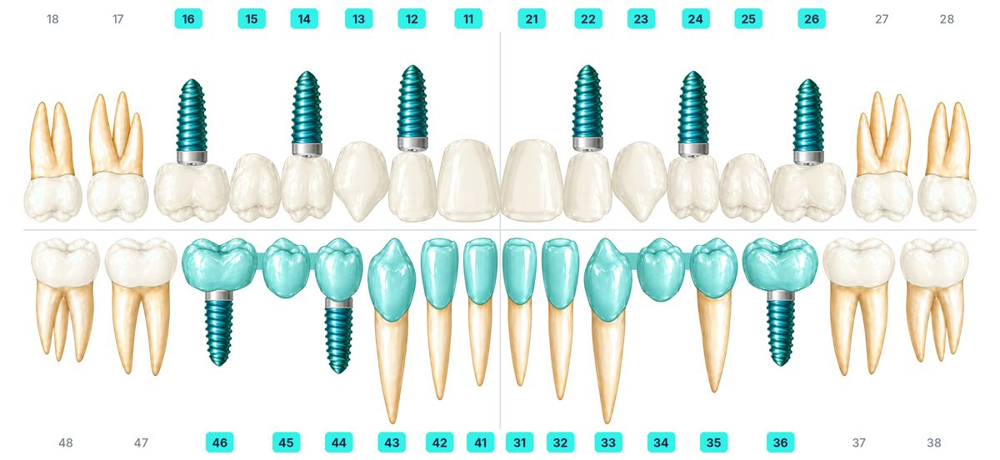


## 4b. Proportion key for the offer system (IT)

The offer system puts each file into a separate box of equal width (16 boxes in a row, object-fit: contain). Cropped files then end up at different scales, and the teeth do not touch each other as they do in nature.

**Files (library "for the system", script `scripts/normalize_images.py`):**
- every file has the same canvas height: **940 px**;
- canvas width = **width of the tooth's slot** (width of the zirconia crown of that tooth + 4 px on the sides), element centred – table below; this way an implant, pontic or temporary crown takes up as much space as the tooth;
- upper jaw: occlusal edge 30 px above the bottom edge of the canvas; lower jaw: 30 px below the top edge; implant alone: platform 265 px from the occlusal edge;
- full arch: height 940 px, width = sum of the slots 16–26 (46–36);
- **missing tooth: `missing_XX.png`** – a transparent slot with the width of the tooth (so that the gap is visible and the neighbouring teeth do not shift);
- drawings are not scaled (32.7 px = 1 mm).

Width of the tooth slot (px on a canvas 940 px high):

| upper jaw | 18 | 17 | 16 | 15 | 14 | 13 | 12 | 11 | 21 | 22 | 23 | 24 | 25 | 26 | 27 | 28 |
|---|---|---|---|---|---|---|---|---|---|---|---|---|---|---|---|---|
| px | 289 | 305 | 337 | 239 | 239 | 255 | 223 | 289 | 289 | 223 | 255 | 239 | 239 | 337 | 305 | 289 |

| lower jaw | 48 | 47 | 46 | 45 | 44 | 43 | 42 | 41 | 31 | 32 | 33 | 34 | 35 | 36 | 37 | 38 |
|---|---|---|---|---|---|---|---|---|---|---|---|---|---|---|---|---|
| px | 337 | 353 | 369 | 238 | 239 | 239 | 190 | 174 | 174 | 190 | 239 | 239 | 238 | 369 | 353 | 337 |

**System (one change in CSS):** instead of equal boxes – a flex row, all images the same height, automatic width:
```css
.row{display:flex;justify-content:center;gap:1px}
.row.up{align-items:flex-end} .row.lo{align-items:flex-start}
.row img{height:96px;width:auto}   /* 96 px fits the whole row on a 520 px screen */
```
Tooth number in the same column as the image (above the upper jaw, below the lower jaw). Full arch = one column with numbers 16–26.
Ready-made example: `system_example/tooth_chart_example.html` (open in a browser).

**Cross-check (6 plans: implants with missing teeth, temporary prostheses, implant bridges, All-on-6 with single teeth, crowns in both arches, extractions and veneers):** the layout built purely from the images in HTML matches the charts from the offers – scale, widths, gaps for missing teeth, implants without crowns, full arch. Things the system must draw itself (they are not in the images):
1. **bridge connector** – a bar in the crown's colour (turquoise, for temporary prostheses amber #E2AA5A) behind the crowns from the first to the last tooth of the bridge;
2. **number of a missing tooth** – grey and crossed out;
3. **numbers below/above a full arch** – distributed according to the widths from the table (not evenly).

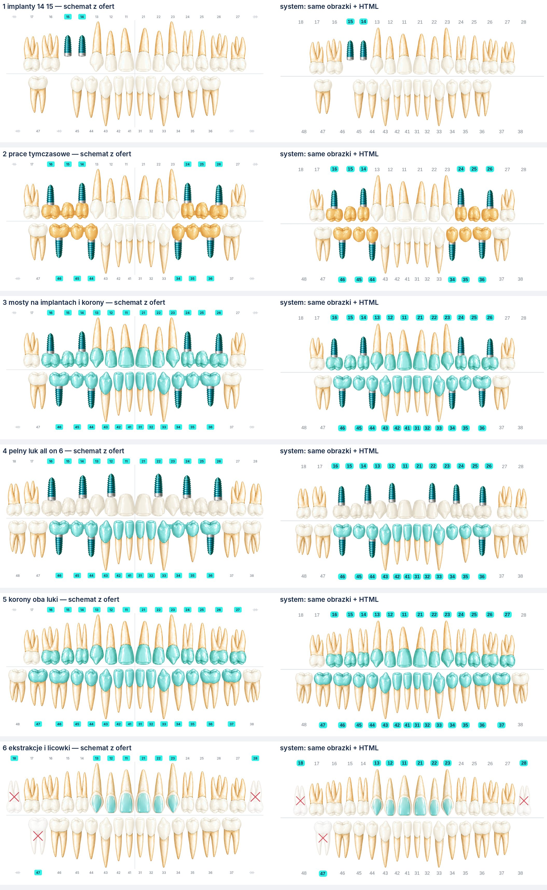

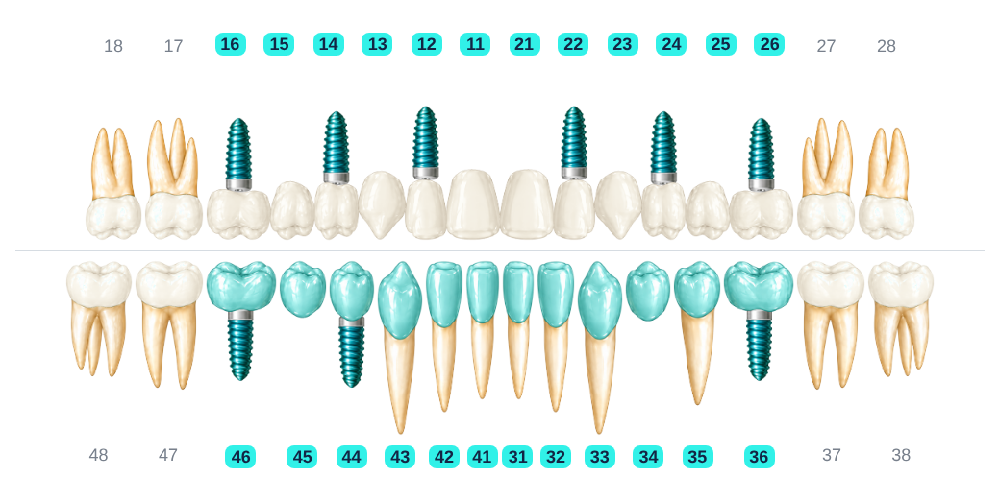

## 5. Examples (preview)

### 01 initial state

Configuration: [`catalog/01_baseline.json`](catalog/01_baseline.json)

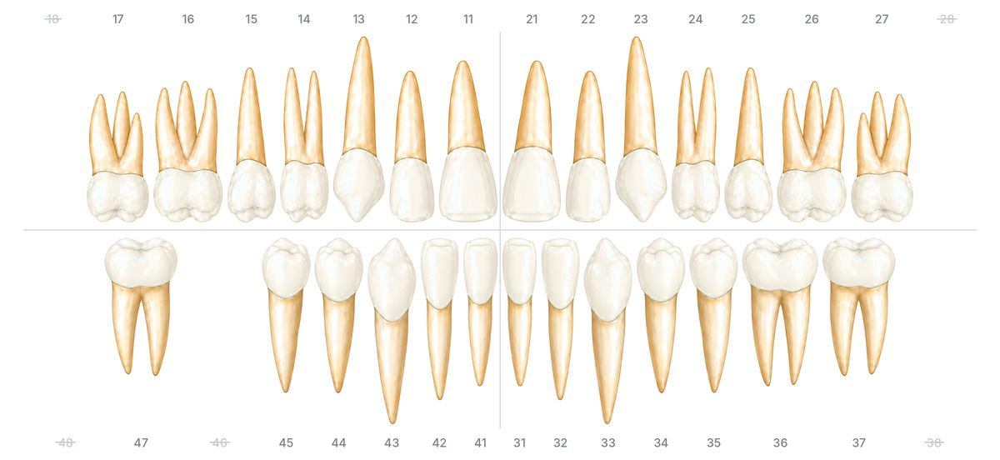

### 02 implants

Configuration: [`catalog/02_implants.json`](catalog/02_implants.json)

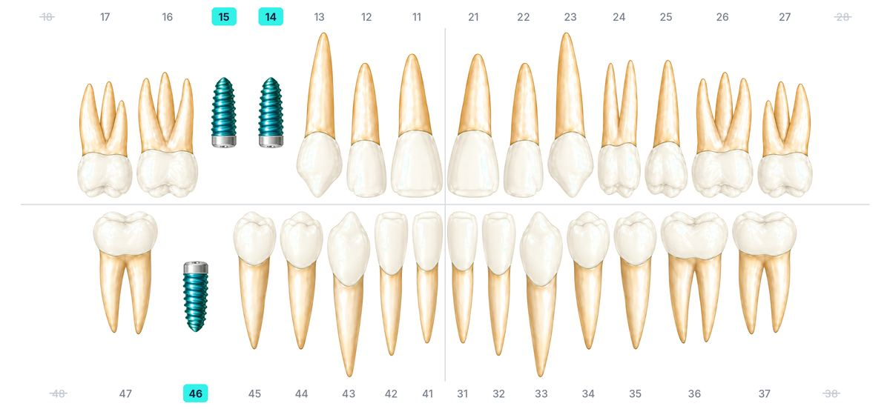

### 03 crowns on implants

Configuration: [`catalog/03_crowns_on_implants.json`](catalog/03_crowns_on_implants.json)

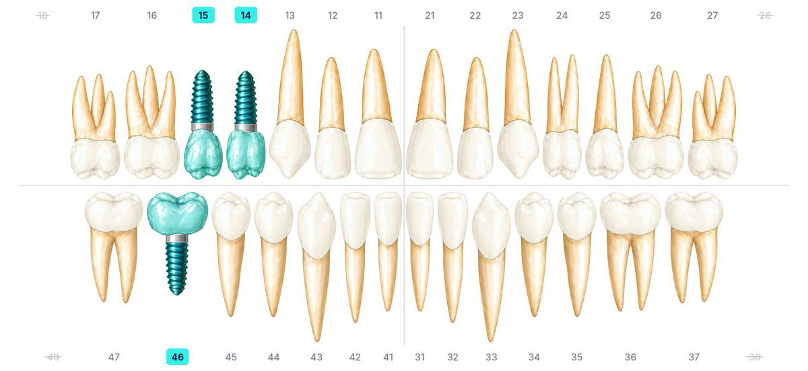

### 04 temporary crowns on implants

Configuration: [`catalog/04_temporary_crowns_on_implants.json`](catalog/04_temporary_crowns_on_implants.json)

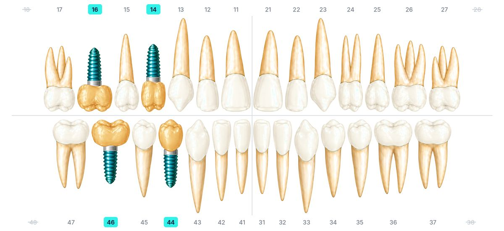

### 05 crowns on own teeth

Configuration: [`catalog/05_crowns_on_natural_teeth.json`](catalog/05_crowns_on_natural_teeth.json)

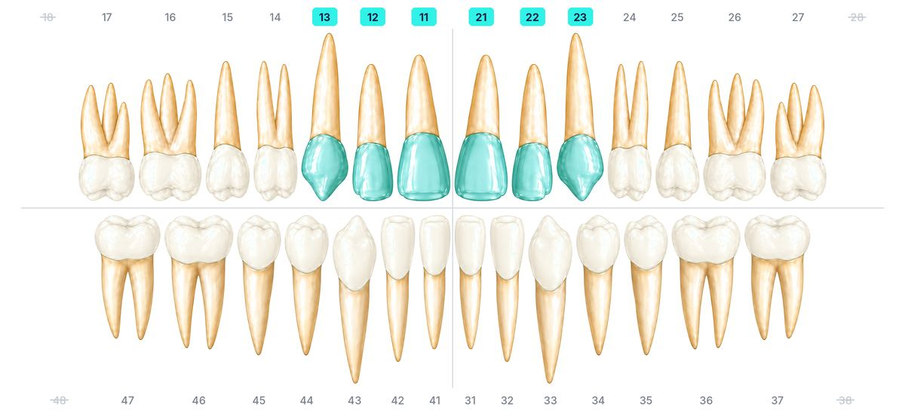

### 06 bridge on own teeth

Configuration: [`catalog/06_bridge_on_natural_teeth.json`](catalog/06_bridge_on_natural_teeth.json)

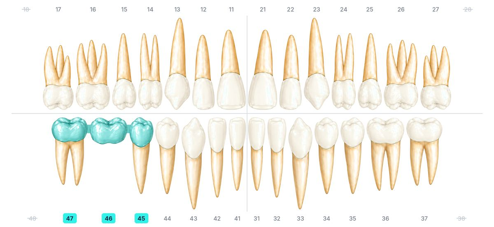

### 07 implant bridge

Configuration: [`catalog/07_implant_bridge.json`](catalog/07_implant_bridge.json)

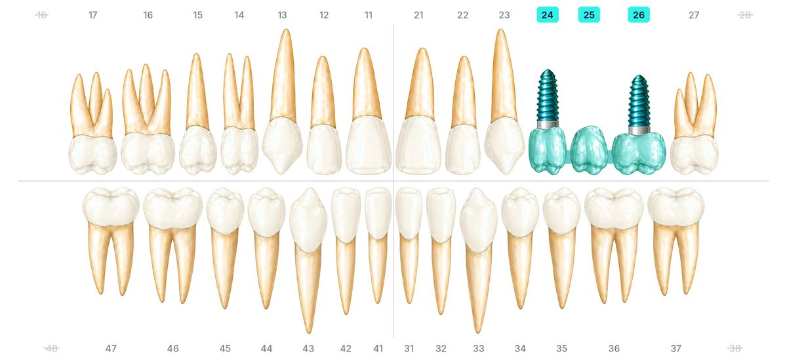

### 08 temporary bridge on implants

Configuration: [`catalog/08_temporary_implant_bridge.json`](catalog/08_temporary_implant_bridge.json)

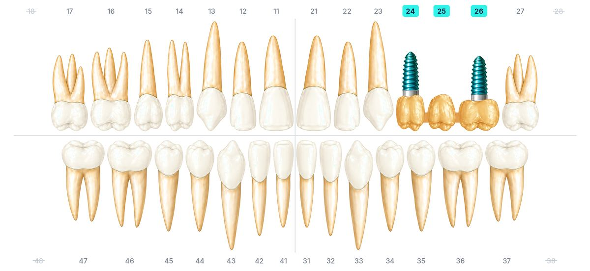

### 09 veneers

Configuration: [`catalog/09_veneers.json`](catalog/09_veneers.json)

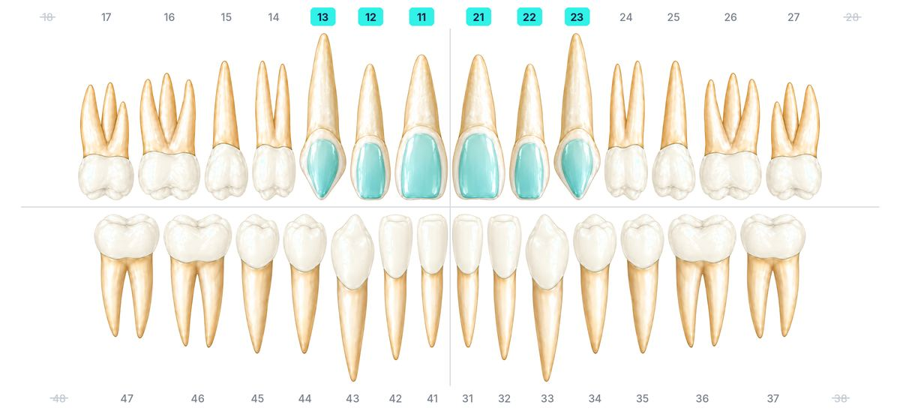

### 10 extractions

Configuration: [`catalog/10_extractions.json`](catalog/10_extractions.json)

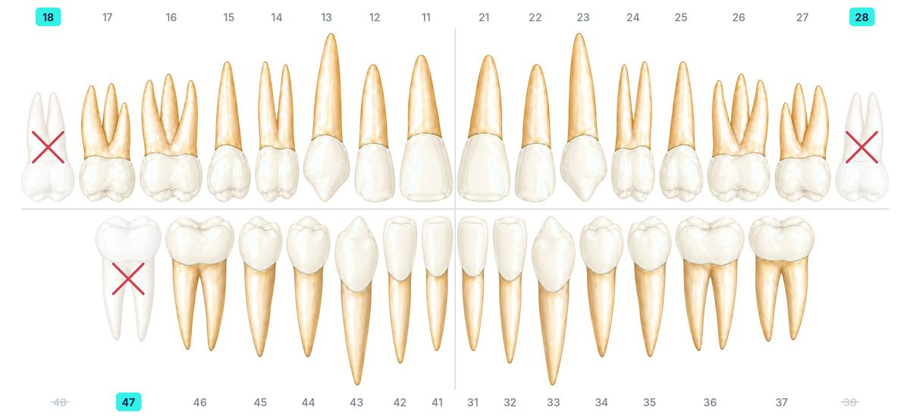

### 11 full arch – temporary prosthesis

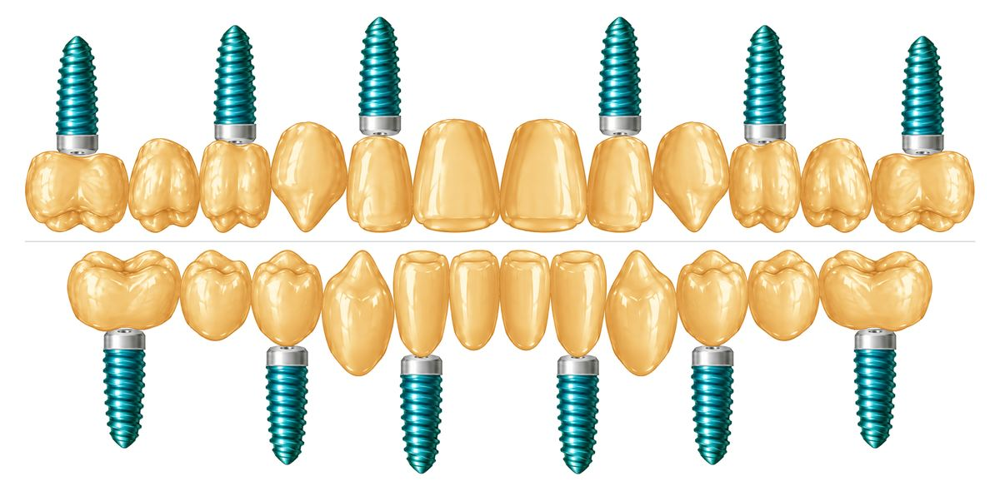

### 12 full arch – hybrid prosthesis

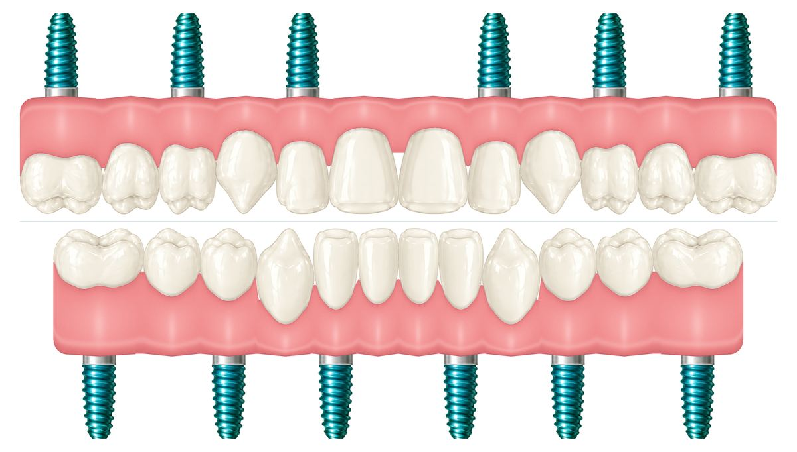

### 13 full arch – 12 crowns

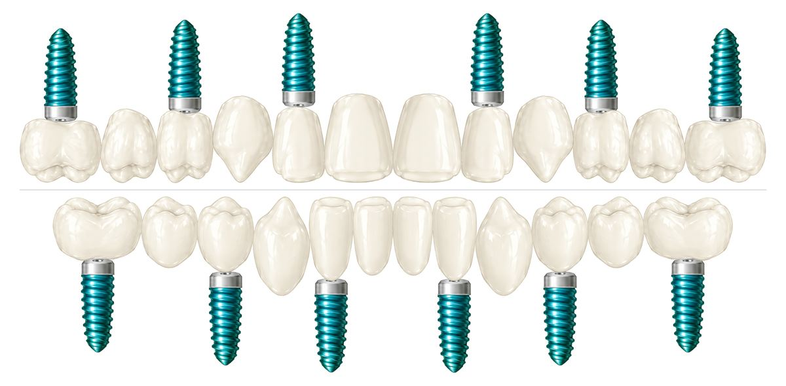

### 14 bilateral sinus lift

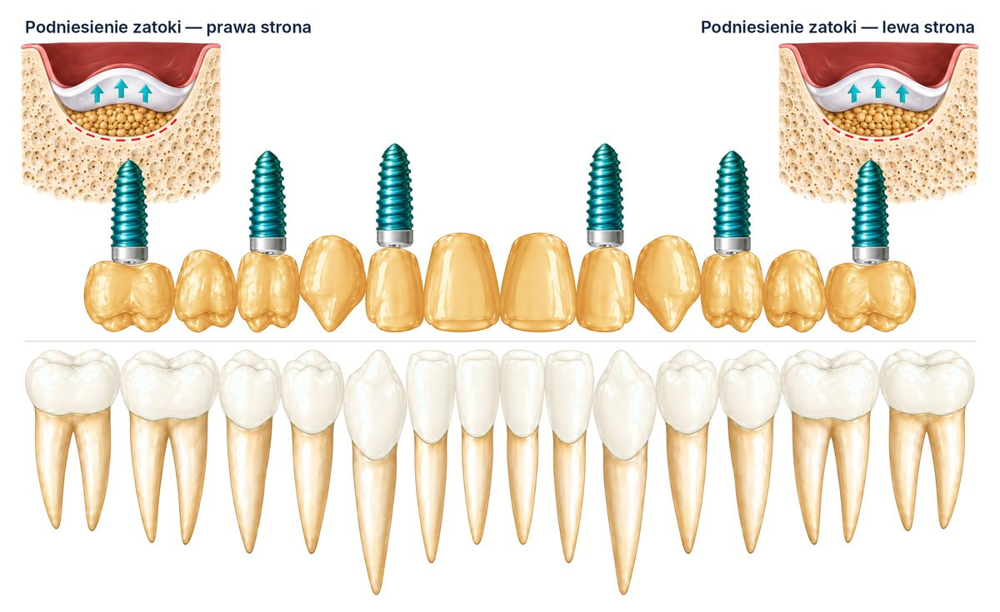

### 15 no implants – removable denture and sinuses

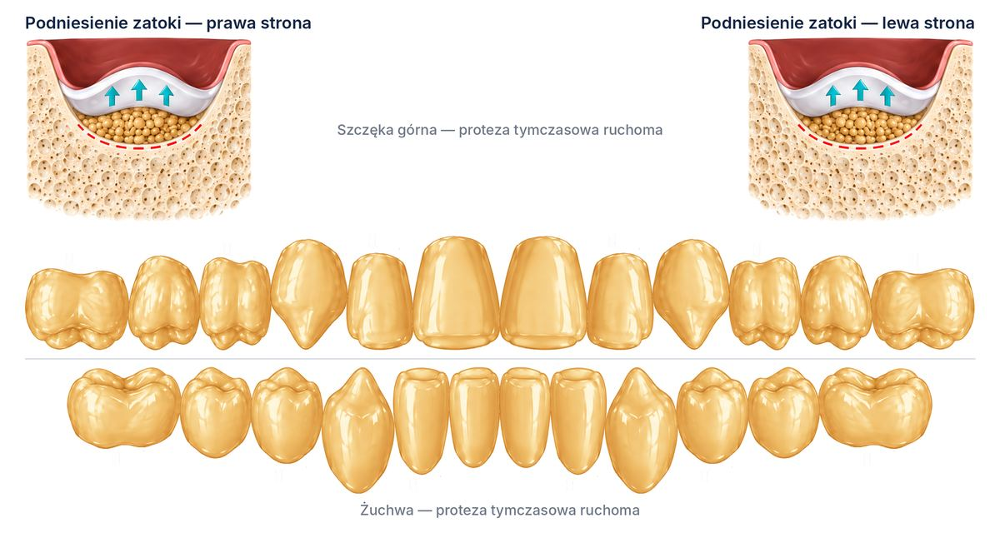

### 16 implants with sinus lift

Configuration: [`catalog/16_implants_with_sinus_lift.json`](catalog/16_implants_with_sinus_lift.json)

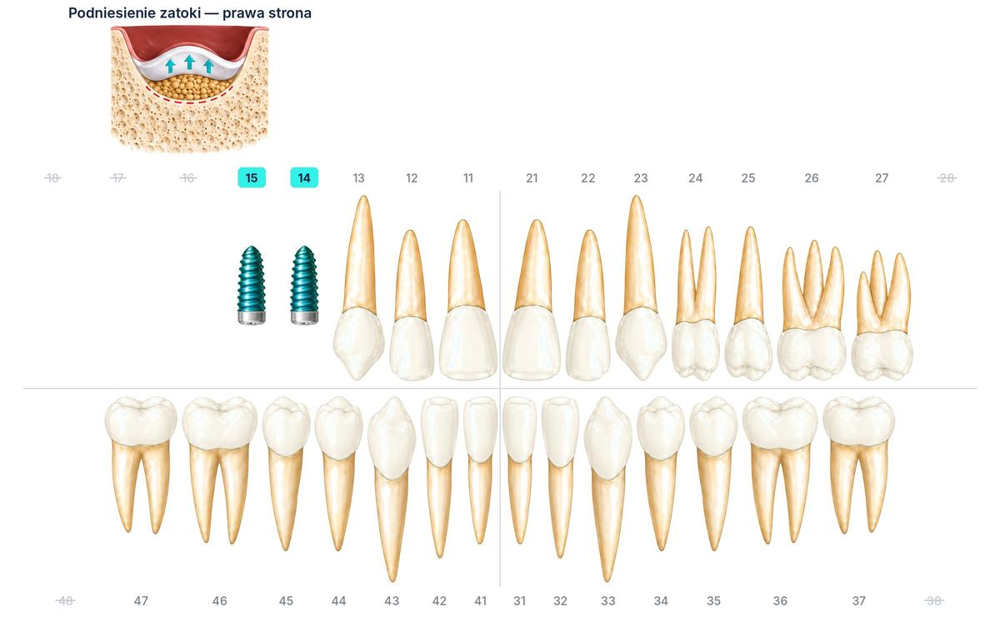

## 6. All library folders on Drive

| Folder | Number of files |
|---|---|
| [Bridge on Natural Teeth – Most na własnych zębach](https://drive.google.com/drive/folders/10o6vf0OHinLx4UfuLWBKAuKQXazpiPWC) | 64 |
| [Dental Implant – Implant](https://drive.google.com/drive/folders/1-Q8PUkKm-1exccWZSQpHOQFOKacp7TUA) | 32 |
| [Filling – Wypełnienie](https://drive.google.com/drive/folders/1XTny89gvVJZ-M0yJEfCDer9z3gtAThvC) | 32 |
| [Full Arch – Pełny łuk](https://drive.google.com/drive/folders/1Do85961dGxnqKyQ3veGQg50unc-9x4Yo) | 16 |
| [Implant Bridge – Most na implantach](https://drive.google.com/drive/folders/1Ftgqhobhviuh5hCObOM-SijT9vpnxAOH) | 64 |
| [Milk Tooth Extraction – Ekstrakcja zęba mlecznego](https://drive.google.com/drive/folders/1M6dgZ6DRcjMlrTkEGmJom8Jx0L-nFThK) | 20 |
| [PMMA Temporary Crown – Korona tymczasowa PMMA](https://drive.google.com/drive/folders/1fvyUnXIeNZ9awLWS3vImPzBz2Fmf-hdf) | 32 |
| [Root Canal Treatment – Leczenie kanałowe](https://drive.google.com/drive/folders/1JO24L8EuCqC9mMqOFDk9q9sTrNCIDFib) | 32 |
| [Sinus Lift – Podniesienie zatoki](https://drive.google.com/drive/folders/1rofLAvLWcZpVBpwTk0l1ZTBy2LV3lxcR) | 2 |
| [Temporary Crown on Implant – Korona tymczasowa na implancie](https://drive.google.com/drive/folders/17vvQUuHxupjLWVQ31C6LNCDU_POH_Rbe) | 32 |
| [Tooth Extraction – Ekstrakcja zęba](https://drive.google.com/drive/folders/1YLMCitgZqzHvG7HR3T1w6jZeNsFKsVjk) | 32 |
| [Veneer – Licówka](https://drive.google.com/drive/folders/1dqm1VJfF_k7eGoddJiX8aZczsnwfJFF0) | 20 |
| [Zirconia Crown on Implant – Korona cyrkonowa na implancie](https://drive.google.com/drive/folders/18B_6hV6D6C4hqSgArjVe80jtBzmLMOTI) | 32 |
| [Zirconia Crown – Korona cyrkonowa](https://drive.google.com/drive/folders/1yta_i1T1jaq5pJ4xGrwFIsYpV9cOoym8) | 32 |
| [Zirconia Implant – Implant cyrkonowy](https://drive.google.com/drive/folders/1NVC4CZ-SDpi_BYMeXLapuVmJLg2w85di) | 32 |
