# Katalog rysunków – co rysujemy w jakiej sytuacji

Biblioteka rysunków na Google Drive: **[New Common Dental Procedures 2026-11-08](https://drive.google.com/drive/folders/1XEiTQqL2fuKYnrzuR0LmhzGtsLRxbgN6)** (foldery „English – Polski”, pliki `<zabieg>_<numer FDI>.png`, przezroczyste tło, jedna skala 32,7 px = 1 mm). Pełna lista plików z linkami: `library/drive_index.csv`. Arkusz procedur: [New Common Dental Procedures 2026-11-08 (arkusz)](https://docs.google.com/spreadsheets/d/18YDUc4iizkf9e4tz5rfCG9JWz-FZioEGAqs0Y-0EIsQ/edit) (eksport: `library/procedures_sheet.csv`).

Zęby naturalne (`natural_11.png` … `natural_48.png`) **nie są na Drive** – są w `library/natural_teeth/` (powstały z koron cyrkonowych przez przemalowanie korony na kolor szkliwa: `scripts/make_natural_teeth.py`).

## 1. Jak powstaje schemat

1. Z RTG i schematu kliniki ustal stan **każdego** z 32 zębów na koniec danej wizyty.
2. Zapisz go w pliku JSON: `{"state": {"<numer>": "<stan>", …}, "bridges": [[od, do], …], "bridge_color": [r,g,b]}`. Zęby nie wpisane = `natural`.
3. `python3 scripts/tooth_chart.py <folder_PNG_z_Drive> library/natural_teeth wynik.png config.json` – skrypt dla każdego zęba bierze plik wg tabeli poniżej, skaluje wszystkie zęby jednym współczynnikiem (szerokość 2400 px), ustawia je obok siebie wzdłuż linii zgryzu, rysuje numery.
4. Jeśli jest podniesienie zatoki: `scripts/add_sinus_lift.py` (rysunek nad 16 i/lub 26).
5. Zmniejsz do 1500 px (JPG, jakość ~74) i podaj w JSON pacjenta jako `schemat` wizyty.

**Zasady rysowania (wspólne):**

- Górny łuk: 18 … 11 | 21 … 28, korzenie do góry; dolny: 48 … 41 | 31 … 38, korzenie w dół. Prawa strona pacjenta = lewa strona obrazka.
- Numer zęba leczonego na tej wizycie (każdy stan inny niż `natural`/`missing`) – w turkusowej pigułce (#31F1E8) z granatowym tekstem.
- `missing` – brak rysunku, numer jasnoszary przekreślony. `natural` – rysunek naturalnego zęba, numer szary.
- Most: `bridges: [[45,47]]` – zaokrąglony łącznik między skrajnymi zębami mostu, za koronami (turkus; dla prac tymczasowych bursztyn `[226,170,90]`).
- Implant bez korony (`implant`) jest przesunięty o 30% wysokości od linii zgryzu (widać, że nie ma korony).
- Kolory: korony stałe – turkus/aqua; prace tymczasowe (PMMA, korony tymczasowe, proteza tymczasowa) – bursztyn; pełne łuki z koronami – biel; dziąsło protezy hybrydowej – róż; implant – turkusowa śruba z tytanową szyjką.

## 2. Stany pojedynczych zębów

| Stan w JSON | Kiedy | Plik (n = numer FDI) | Folder na Drive | Jak wygląda | Przykład |
|---|---|---|---|---|---|
| `natural` | Ząb własny pacjenta, bez zabiegu na tej wizycie (widoczny na RTG). | `natural_{n}.png` | — | Naturalny ząb: korona w kolorze szkliwa, korzeń beżowy. Numer szary. | [01_baseline.jpg](catalog/01_baseline.jpg) |
| `missing` | Zęba nie ma (brak na RTG, wcześniej usunięty, ósemki nieobecne). Także ząb usunięty na wizycie I – na schemacie wizyty II. | `—` | — | Brak rysunku, numer szary i przekreślony. | [01_baseline.jpg](catalog/01_baseline.jpg) |
| `extraction` | Ekstrakcja na danej wizycie (zwykła lub chirurgiczna). | `extraction_{n}.png` | [Tooth Extraction – Ekstrakcja zęba](https://drive.google.com/drive/folders/1YLMCitgZqzHvG7HR3T1w6jZeNsFKsVjk) | Blady zarys zęba z cienkim czerwonym X. Numer w turkusowej pigułce. | [10_extractions.jpg](catalog/10_extractions.jpg) |
| `implant` | Implant wszczepiony na wizycie I, bez korony (gojenie). | `implant_{n}.png` | [Dental Implant – Implant](https://drive.google.com/drive/folders/1-Q8PUkKm-1exccWZSQpHOQFOKacp7TUA) | Sam implant (turkusowa śruba), lekko obniżony względem linii zgryzu. Numer podświetlony. | [02_implants.jpg](catalog/02_implants.jpg) |
| `implant_crown` | Korona cyrkonowa Amann Girrbach lub Ivoclar na implancie (zwykle wizyta II). | `zirconia_crown_on_implant_{n}.png` | [Zirconia Crown on Implant – Korona cyrkonowa na implancie](https://drive.google.com/drive/folders/18B_6hV6D6C4hqSgArjVe80jtBzmLMOTI) | Turkusowa korona na jednolitym implancie. | [03_crowns_on_implants.jpg](catalog/03_crowns_on_implants.jpg) |
| `temp_implant` | Tymczasowa korona na implancie / filar stałej tymczasowej pracy na implantach (wizyta I). | `temporary_crown_on_implant_{n}.png` | [Temporary Crown on Implant – Korona tymczasowa na implancie](https://drive.google.com/drive/folders/17vvQUuHxupjLWVQ31C6LNCDU_POH_Rbe) | Bursztynowa korona na implancie. | [04_temporary_crowns_on_implants.jpg](catalog/04_temporary_crowns_on_implants.jpg) |
| `crown` | Korona cyrkonowa Amann Girrbach lub Ivoclar na własnym zębie; także filar mostu na własnych zębach. | `zirconia_crown_{n}.png` | [Zirconia Crown – Korona cyrkonowa](https://drive.google.com/drive/folders/1yta_i1T1jaq5pJ4xGrwFIsYpV9cOoym8) | Turkusowa korona na naturalnym korzeniu. | [05_crowns_on_natural_teeth.jpg](catalog/05_crowns_on_natural_teeth.jpg) |
| `pontic` | Przęsło mostu na własnych zębach (ząb brakujący zastąpiony koroną bez korzenia). | `bridge_pontic_{n}.png` | [Bridge on Natural Teeth – Most na własnych zębach](https://drive.google.com/drive/folders/10o6vf0OHinLx4UfuLWBKAuKQXazpiPWC) | Sama turkusowa korona, bez korzenia; łącznik mostu za koronami. | [06_bridge_on_natural_teeth.jpg](catalog/06_bridge_on_natural_teeth.jpg) |
| `implant_pontic` | Przęsło mostu na implantach. | `implant_bridge_pontic_{n}.png` | [Implant Bridge – Most na implantach](https://drive.google.com/drive/folders/1Ftgqhobhviuh5hCObOM-SijT9vpnxAOH) | Turkusowa korona bez korzenia między koronami na implantach; łącznik w kolorze korony. | [07_implant_bridge.jpg](catalog/07_implant_bridge.jpg) |
| `temp_pontic` | Przęsło stałej tymczasowej pracy na implantach. | `temp_pontic_{n}.png (generowany – patrz uwaga)` | [Implant Bridge – Most na implantach](https://drive.google.com/drive/folders/1Ftgqhobhviuh5hCObOM-SijT9vpnxAOH) | Bursztynowa korona bez korzenia; łącznik bursztynowy (bridge_color [226,170,90]). | [08_temporary_implant_bridge.jpg](catalog/08_temporary_implant_bridge.jpg) |
| `veneer` | Licówka porcelanowa Laminate Veneer (rysunki tylko dla zębów 11–15, 21–25, 31–35, 41–45). | `veneer_{n}.png` | [Veneer – Licówka](https://drive.google.com/drive/folders/1dqm1VJfF_k7eGoddJiX8aZczsnwfJFF0) | Cienka turkusowa łuska na przedniej powierzchni zęba. | [09_veneers.jpg](catalog/09_veneers.jpg) |

Przykładowe pliki na Drive (ząb 36 lub 11): [implant_36.png](https://drive.google.com/file/d/1jKu3DVz3FNl8aYiNjDd-UodKdzxTvAfp/view?usp=drivesdk), [zirconia_crown_36.png](https://drive.google.com/file/d/1RN72UlrucP_6ke8pTq4uA6ao9I4RKtUm/view?usp=drivesdk), [zirconia_crown_on_implant_36.png](https://drive.google.com/file/d/1vsqQnu9sYPcf3gtZpvv62u5I_6h_ycoW/view?usp=drivesdk), [temporary_crown_on_implant_36.png](https://drive.google.com/file/d/1UkIlOar3vqQ1GUR8DQASx7FRUoxRdixs/view?usp=drivesdk), [temporary_crown_pmma_36.png](https://drive.google.com/file/d/1ZgRMuG1WND_6Bt2PqrHVQmsUGq39lgrZ/view?usp=drivesdk), [bridge_pontic_36.png](https://drive.google.com/file/d/1J_JMGXlFY2-ffhpt9m6DoQcMGOh3BDWf/view?usp=drivesdk), [bridge_abutment_36.png](https://drive.google.com/file/d/1hBCsajH12ke4Rriy6kTcDF9SKk2Ataa3/view?usp=drivesdk), [implant_bridge_pontic_36.png](https://drive.google.com/file/d/10_t4UZ-557lo0Ur_OSrzJSoY9y21ISnC/view?usp=drivesdk), [implant_bridge_abutment_36.png](https://drive.google.com/file/d/1e0JmIF7ozmrseDIG5ROzbENHsjQW16MS/view?usp=drivesdk), [extraction_36.png](https://drive.google.com/file/d/1z6nnDpKnOJEcPKZBZd0nViFg31RRkpYA/view?usp=drivesdk), [veneer_11.png](https://drive.google.com/file/d/1w8knPoIP2z9TjUtAUnAcyvENpoxfp1R7/view?usp=drivesdk), [root_canal_36.png](https://drive.google.com/file/d/1EOQPmFFdp44Xnlz-vUXw_uEUSebgNGW8/view?usp=drivesdk), [filling_36.png](https://drive.google.com/file/d/1FbTQqkS1g2xENYWrxfVwGeVX8LsKEjxJ/view?usp=drivesdk), [zirconia_implant_36.png](https://drive.google.com/file/d/1CgecceixAqTbpP7L0N3nCcxoV1m7OLP8/view?usp=drivesdk).

> Uwaga: rysunków `temp_pontic_{n}.png` (przęsło stałej pracy tymczasowej) **nie ma na Drive** – generuje je `scripts/make_temp_pontics.py` z `implant_bridge_pontic_{n}.png` (przemalowanie na bursztyn PMMA). Zęby naturalne `natural_{n}.png` – podobnie, z `zirconia_crown_{n}.png` (`scripts/make_natural_teeth.py`, gotowe w `library/natural_teeth/`). Wszystkie PNG z Drive pobieramy do **jednego płaskiego folderu** i podajemy go jako pierwszy argument `tooth_chart.py`.

## 3. Jak przełożyć zabieg z PDF kliniki na stan zęba

| Pozycja w PDF kliniki | Schemat wizyty I | Schemat wizyty II |
|---|---|---|
| Implant (Medentika / Straumann) | `implant` | zależnie od korony: `implant_crown` / `implant_pontic` |
| Implant + tymczasowa korona na implancie (55 EUR) | `temp_implant` | `implant_crown` |
| Implanty + stała tymczasowa praca protetyczna (1 łuk, 421 EUR) | filary `temp_implant`, przęsła `temp_pontic`, łącznik bursztynowy; przy całym łuku – rysunek pełnego łuku (rozdz. 4) | korony / most / proteza hybrydowa |
| Korona cyrkonowa na własnym zębie | `natural` (ząb jeszcze nieoszlifowany) | `crown` |
| Most na własnych zębach (np. 45–47) | `natural` filary, `missing` w miejscu przęsła | filary `crown`, przęsło `pontic`, `bridges: [[45,47]]` |
| Most na implantach (np. 24–26) | `implant` na filarach, `missing` w przęśle | `implant_crown` + `implant_pontic`, `bridges: [[24,26]]` |
| Licówka Laminate Veneer | `natural` | `veneer` |
| Korona porcelanowa Empress | `natural` | `crown` (ten sam rysunek co cyrkon – opis w tekście) |
| Ekstrakcja / ekstrakcja chirurgiczna | `extraction` | `missing` (albo implant/przęsło, jeśli tak w planie) |
| Podniesienie zatoki | rysunek zatoki nad 16 i/lub 26 (`add_sinus_lift.py`) | bez zatoki |
| Leczenie kanałowe | nie rysujemy osobno (ząb pod koronę) | `crown` |
| Ząb istniejący na RTG, bez zabiegu (też ósemki) | `natural` | `natural` |
| Brak zęba na RTG | `missing` | `missing` |

## 4. Pełne łuki i zatoki

Folder: [Full Arch – Pełny łuk](https://drive.google.com/drive/folders/1Do85961dGxnqKyQ3veGQg50unc-9x4Yo), [Sinus Lift – Podniesienie zatoki](https://drive.google.com/drive/folders/1rofLAvLWcZpVBpwTk0l1ZTBy2LV3lxcR). Skrypty: `full_arch_chart.py <górny.png> <dolny.png> <wynik> [zatoka.png] [both]`, `sinus_without_implants_chart.py`.

| Sytuacja | Rysunek | Plik(i) na Drive | Przykład |
|---|---|---|---|
| Stała tymczasowa praca na implantach – cały łuk (All-on-6 / All-on-4) | bursztynowy łuk koron na 6 (lub 4) implantach | [temporary_prosthesis_upper_all-on-6.png](https://drive.google.com/file/d/147whEFsrfbDyQHhtoBsEY7nFMI7rWfTv/view?usp=drivesdk), [temporary_prosthesis_lower_all-on-6.png](https://drive.google.com/file/d/1U659JNVrQS1yN0LInb9Mc8-_FjXToH9u/view?usp=drivesdk), [temporary_prosthesis_upper_all-on-4.png](https://drive.google.com/file/d/1sDtwv4rBfynLEFXHEc1FdZpcyY3FjWim/view?usp=drivesdk), [temporary_prosthesis_lower_all-on-4.png](https://drive.google.com/file/d/1QkJGAWbZ38h0VK_cFXjlNz-SdRtbSEHY/view?usp=drivesdk) | [11_full_arch_temporary_prosthesis.jpg](catalog/11_full_arch_temporary_prosthesis.jpg) |
| Wizyta II: proteza hybrydowa na implantach | białe zęby z różowym dziąsłem na implantach | [hybrid_prosthesis_upper_all-on-6.png](https://drive.google.com/file/d/1PDmTOJK_wP47iTnAJCPQMOJmBA_N8ier/view?usp=drivesdk), [hybrid_prosthesis_lower_all-on-6.png](https://drive.google.com/file/d/1IxDW-briUMApBKHWt7aR4gQt2fvG7mLV/view?usp=drivesdk), [hybrid_prosthesis_upper_all-on-4.png](https://drive.google.com/file/d/1cdgseibUKZEd9Q1qQJHdAsLJOWbFWFUt/view?usp=drivesdk), [hybrid_prosthesis_lower_all-on-4.png](https://drive.google.com/file/d/1CUnkRgmNy2dRz-nhF3MbIbh44E4qtgAe/view?usp=drivesdk) | [12_full_arch_hybrid_prosthesis.jpg](catalog/12_full_arch_hybrid_prosthesis.jpg) |
| Wizyta II: 12 koron cyrkonowych na implantach w łuku | białe korony na implantach, bez dziąsła | [12_zirconia_crowns_upper_all-on-6.png](https://drive.google.com/file/d/18NAkhnHnbvChOFKMpL-TjcwuwTqixvRo/view?usp=drivesdk), [12_zirconia_crowns_lower_all-on-6.png](https://drive.google.com/file/d/1WsdX0o39CKQZW7fXCiG3m9RhvAq__M_b/view?usp=drivesdk), [12_zirconia_crowns_upper_all-on-4.png](https://drive.google.com/file/d/1687QrS5trgV65JbY-EpambA6mCYqMH-v/view?usp=drivesdk), [12_zirconia_crowns_lower_all-on-4.png](https://drive.google.com/file/d/1IMhLiY389EXJHguvw_qL2tuJzj6V7GLU/view?usp=drivesdk) | [13_full_arch_12_crowns.jpg](catalog/13_full_arch_12_crowns.jpg) |
| Proteza Toronto (z belką tytanową) | białe zęby + dziąsło + szara belka | [toronto_prosthesis_upper_all-on-6.png](https://drive.google.com/file/d/16TFGMmNwu_U9J9juvkFhE1f1S58aFXGA/view?usp=drivesdk), [toronto_prosthesis_lower_all-on-6.png](https://drive.google.com/file/d/1VzuVu8SzTzfALHI5uFLqVmeDm-G1t1qk/view?usp=drivesdk) |  |
| Podniesienie zatoki przy pełnym łuku (obie strony) | rysunki zatok nad trzonowcami, podpis „Podniesienie zatoki — prawa/lewa strona” | [sinus_lift_one_side.png](https://drive.google.com/file/d/1qOHXQLQR8yCWx2JpNxRCL4HBNagfe2DF/view?usp=drivesdk), [wide_sinus_lift_one_side.png](https://drive.google.com/file/d/1_lT2wDIjPVmRQkFWFHVj2vMtApAJiAe4/view?usp=drivesdk) | [14_sinus_lift_both_sides.jpg](catalog/14_sinus_lift_both_sides.jpg) |
| Podniesienie zatoki przy pojedynczych implantach | schemat zębów + pasek z rysunkiem zatoki nad 16/26 | [sinus_lift_one_side.png](https://drive.google.com/file/d/1qOHXQLQR8yCWx2JpNxRCL4HBNagfe2DF/view?usp=drivesdk) | [16_implants_with_sinus_lift.jpg](catalog/16_implants_with_sinus_lift.jpg) |
| Bez implantów na wizycie I (proteza ruchoma) + zatoki | łuki tymczasowe bez implantów + zatoki | [sinus_lift_one_side.png](https://drive.google.com/file/d/1qOHXQLQR8yCWx2JpNxRCL4HBNagfe2DF/view?usp=drivesdk) | [15_no_implants_removable_and_sinus.jpg](catalog/15_no_implants_removable_and_sinus.jpg) |

Implanty w pełnych łukach: All-on-6 – proste w 16/14/12/22/24/26 i 46/44/42/32/34/36; All-on-4 – proste 12/22 i 42/32, pochylone 35° w 15/25 i 45/35.


## 4a. Pełny łuk razem z pojedynczymi zębami — proporcje

Częsty błąd: każdy element skalowany osobno (np. łuk dopasowany do szerokości ekranu, a ósemki do stałej wysokości). Wtedy łuk jest ogromny, a zęby obok malutkie.

**Zasada:** wszystkie rysunki biblioteki mają jedną skalę (32,7 px = 1 mm), więc:
1. Liczymy jeden współczynnik skali dla całego schematu (z szerokości 16 zębów rzędu) — tak jak `tooth_chart.py`.
2. Rysunek pełnego łuku wstawiamy dokładnie w miejsce zębów, które obejmuje (np. All-on-6 górny = od lewej krawędzi zęba 16 do prawej krawędzi 26), dolną krawędzią koron na linii zgryzu. Szerokość łuku 16–26 w bibliotece (~2990 px) prawie równa się sumie szerokości pojedynczych koron 16–26, więc proporcje się zgadzają.
3. Zęby poza łukiem (np. 18, 17, 27, 28) rysujemy normalnie, tą samą skalą.
4. Numery zębów objętych łukiem — w turkusowej pigułce.

Konfiguracja (`tooth_chart.py`):
```json
{"state": {"46":"implant_crown","45":"implant_pontic","44":"implant_crown","34":"pontic"},
 "bridges": [[46,44],[33,35]],
 "arch": {"upper": {"file": "12_zirconia_crowns_upper_all-on-6.png", "from": 16, "to": 26}}}
```
Przykład: [catalog/17_full_arch_with_single_teeth.jpg](catalog/17_full_arch_with_single_teeth.jpg)

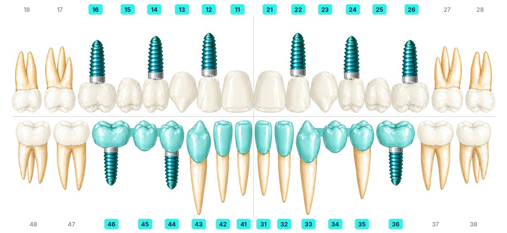


## 4b. Klucz proporcji dla systemu ofert (IT)

System ofert wkleja każdy plik do osobnego pola o równej szerokości (16 pól w rzędzie, object-fit: contain). Przycięte pliki dostają wtedy różną skalę, a zęby nie stykają się jak w naturze.

**Pliki (library „do systemu”, skrypt `scripts/normalize_images.py`):**
- każdy plik ma tę samą wysokość płótna: **940 px**;
- szerokość płótna = **szerokość miejsca zęba** (szerokość korony cyrkonowej tego zęba + 4 px z boków), element na środku – tabela niżej; dzięki temu implant, przęsło czy korona tymczasowa zajmują tyle miejsca co ząb;
- szczęka: krawędź zgryzowa 30 px nad dolną krawędzią płótna; żuchwa: 30 px pod górną; sam implant: platforma 265 px od krawędzi zgryzowej;
- pełny łuk: wysokość 940 px, szerokość = suma miejsc 16–26 (46–36);
- **brak zęba: `missing_XX.png`** – przezroczyste miejsce o szerokości zęba (żeby luka była widoczna, a sąsiednie zęby się nie przesuwały);
- rysunków nie skalujemy (32,7 px = 1 mm).

Szerokość miejsca zęba (px na płótnie 940 px wysokości):

| szczęka | 18 | 17 | 16 | 15 | 14 | 13 | 12 | 11 | 21 | 22 | 23 | 24 | 25 | 26 | 27 | 28 |
|---|---|---|---|---|---|---|---|---|---|---|---|---|---|---|---|---|
| px | 289 | 305 | 337 | 239 | 239 | 255 | 223 | 289 | 289 | 223 | 255 | 239 | 239 | 337 | 305 | 289 |

| żuchwa | 48 | 47 | 46 | 45 | 44 | 43 | 42 | 41 | 31 | 32 | 33 | 34 | 35 | 36 | 37 | 38 |
|---|---|---|---|---|---|---|---|---|---|---|---|---|---|---|---|---|
| px | 337 | 353 | 369 | 238 | 239 | 239 | 190 | 174 | 174 | 190 | 239 | 239 | 238 | 369 | 353 | 337 |

**System (jedna zmiana w CSS):** zamiast równych pól – rząd flex, wszystkie obrazki tej samej wysokości, szerokość automatyczna:
```css
.row{display:flex;justify-content:center;gap:1px}
.row.up{align-items:flex-end} .row.lo{align-items:flex-start}
.row img{height:96px;width:auto}   /* 96 px mieści cały rząd na ekranie 520 px */
```
Numer zęba w tej samej kolumnie co obrazek (nad szczęką, pod żuchwą). Pełny łuk = jedna kolumna z numerami 16–26.
Gotowy przykład: `system_example/tooth_chart_example.html` (otwórz w przeglądarce).

**Test krzyżowy (6 planów: implanty z brakami, prace tymczasowe, mosty na implantach, All-on-6 z pojedynczymi zębami, korony w obu łukach, ekstrakcje i licówki):** układ z samych obrazków w HTML zgadza się ze schematami z ofert – skala, szerokości, luki po brakach, implanty bez koron, pełny łuk. Rzeczy, które system musi dorysować sam (nie są w obrazkach):
1. **łącznik mostu** – pasek w kolorze korony (turkus, przy pracach tymczasowych bursztyn #E2AA5A) za koronami od pierwszego do ostatniego zęba mostu;
2. **numer brakującego zęba** – szary i przekreślony;
3. **numery pod/nad pełnym łukiem** – rozłożone wg szerokości z tabeli (nie równo).

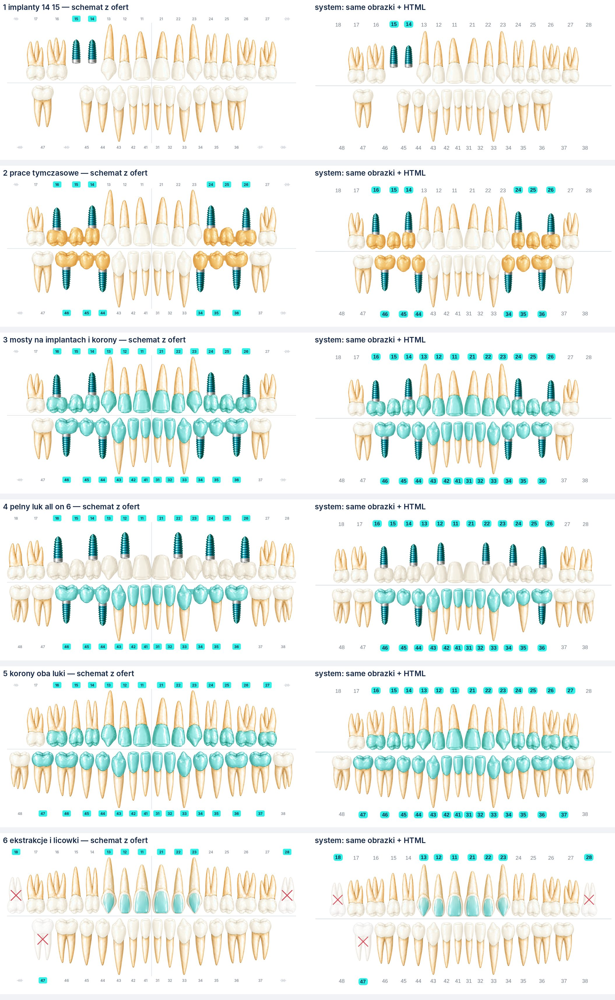

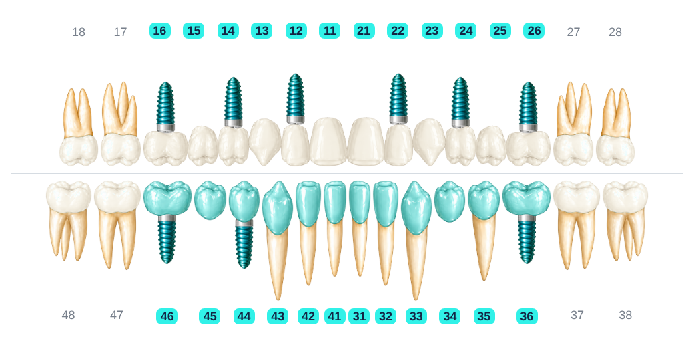

## 5. Przykłady (podgląd)

### 01 stan wyjsciowy

Konfiguracja: [`catalog/01_baseline.json`](catalog/01_baseline.json)

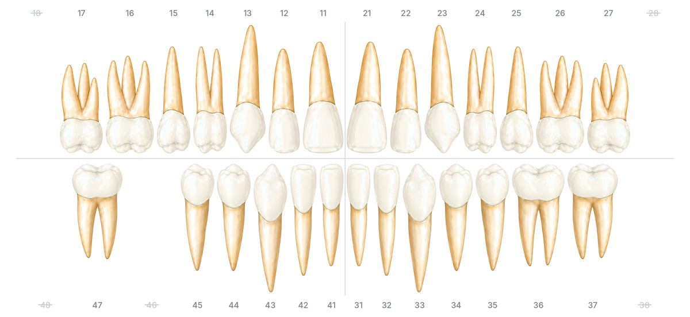

### 02 implanty

Konfiguracja: [`catalog/02_implants.json`](catalog/02_implants.json)

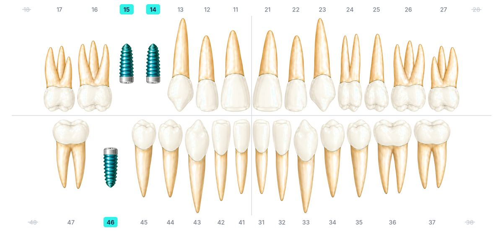

### 03 korony na implantach

Konfiguracja: [`catalog/03_crowns_on_implants.json`](catalog/03_crowns_on_implants.json)

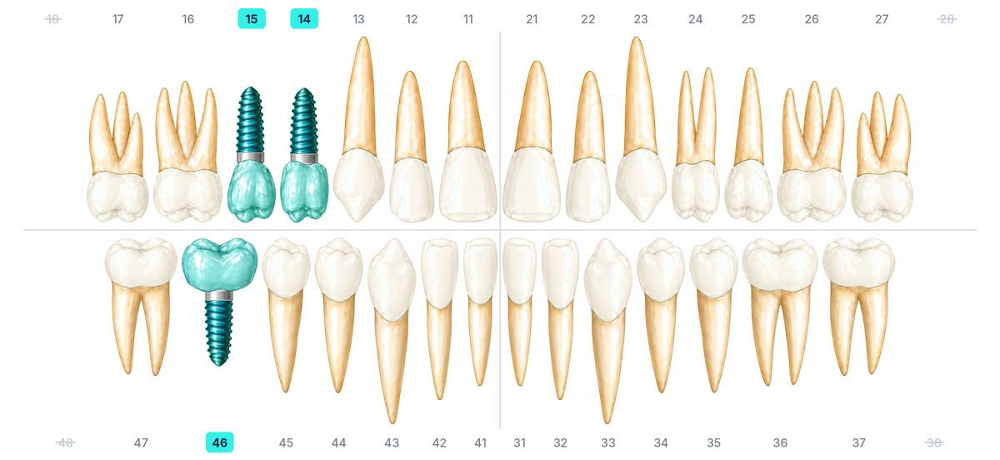

### 04 korony tymczasowe na implantach

Konfiguracja: [`catalog/04_temporary_crowns_on_implants.json`](catalog/04_temporary_crowns_on_implants.json)

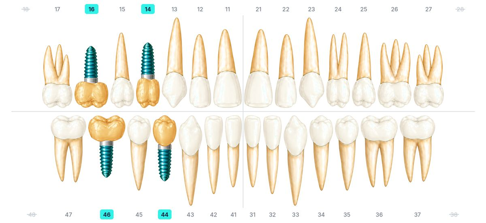

### 05 korony na wlasnych zebach

Konfiguracja: [`catalog/05_crowns_on_natural_teeth.json`](catalog/05_crowns_on_natural_teeth.json)

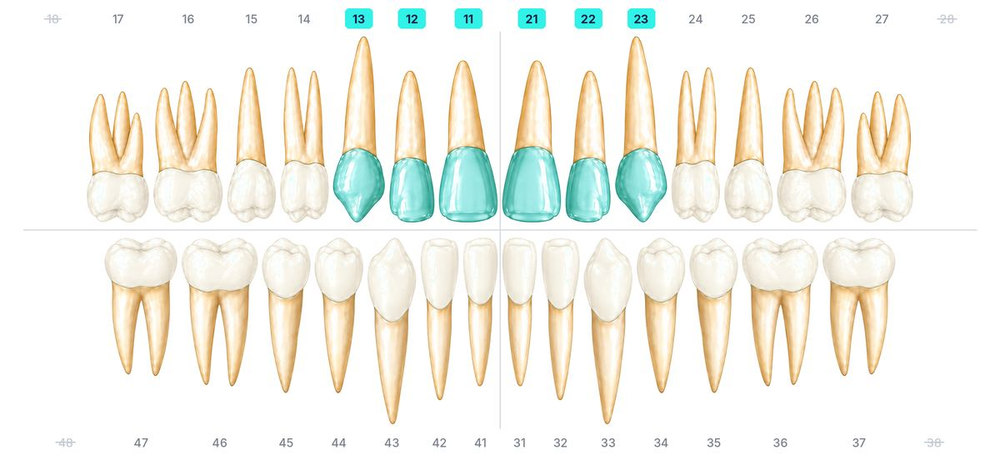

### 06 most na wlasnych zebach

Konfiguracja: [`catalog/06_bridge_on_natural_teeth.json`](catalog/06_bridge_on_natural_teeth.json)

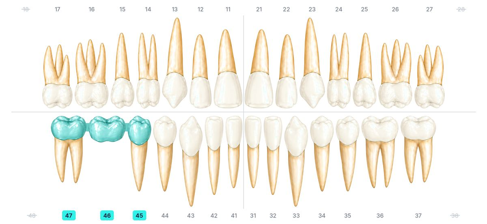

### 07 most na implantach

Konfiguracja: [`catalog/07_implant_bridge.json`](catalog/07_implant_bridge.json)

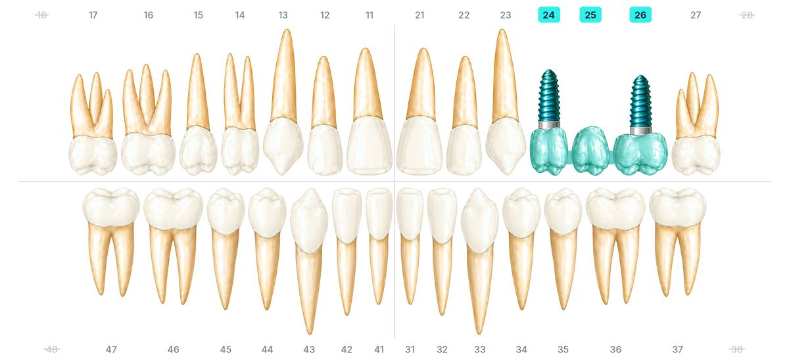

### 08 most tymczasowy na implantach

Konfiguracja: [`catalog/08_temporary_implant_bridge.json`](catalog/08_temporary_implant_bridge.json)

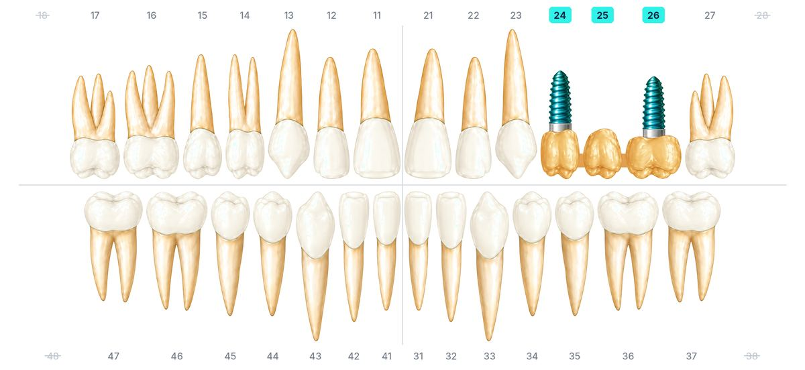

### 09 licowki

Konfiguracja: [`catalog/09_veneers.json`](catalog/09_veneers.json)

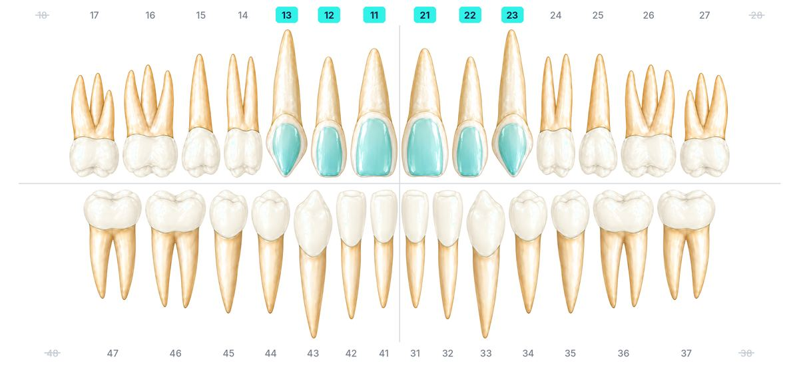

### 10 ekstrakcje

Konfiguracja: [`catalog/10_extractions.json`](catalog/10_extractions.json)

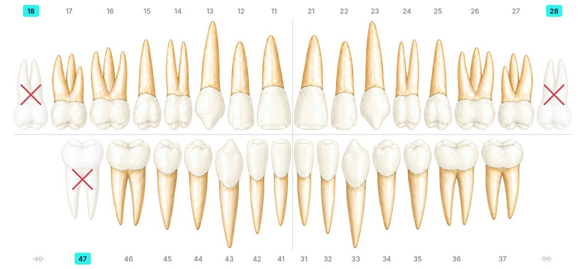

### 11 pelny luk proteza tymczasowa

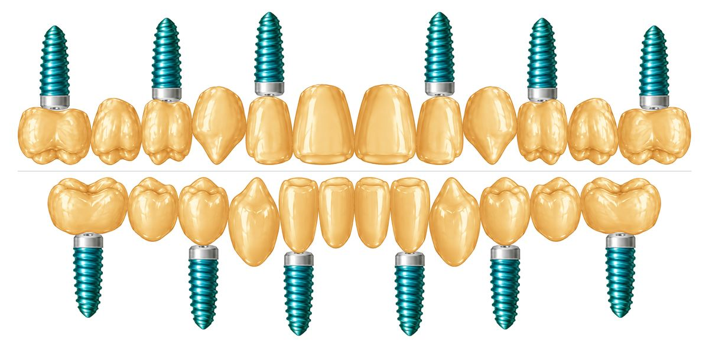

### 12 pelny luk proteza hybrydowa

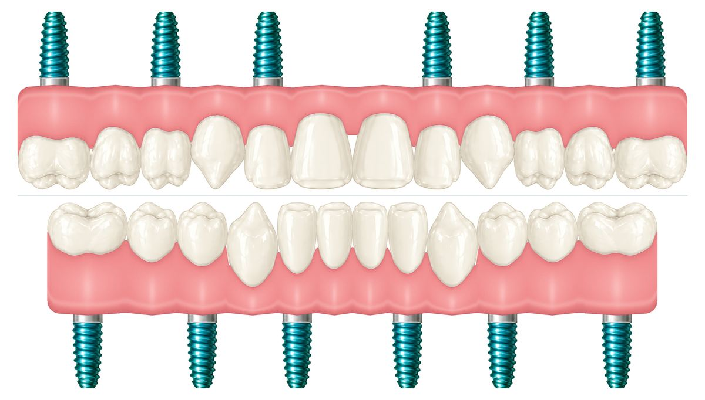

### 13 pelny luk 12 koron

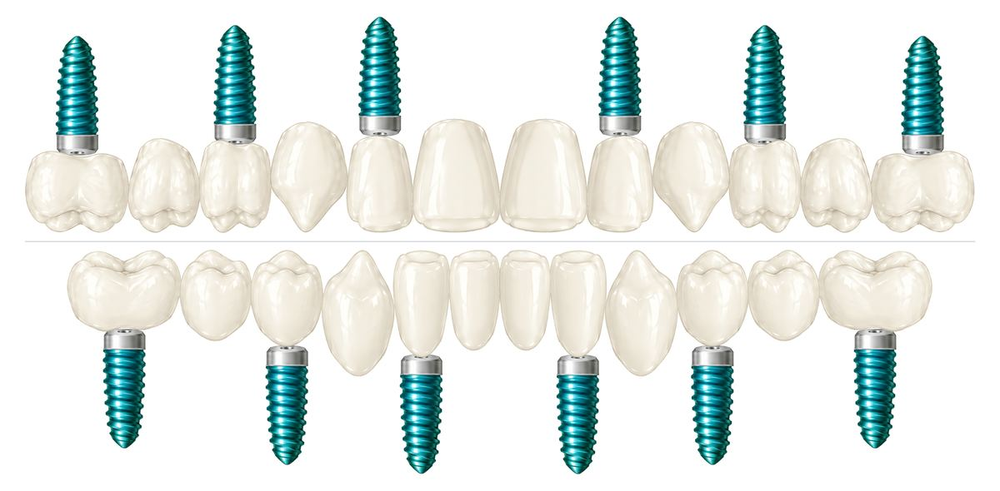

### 14 podniesienie zatoki obustronne

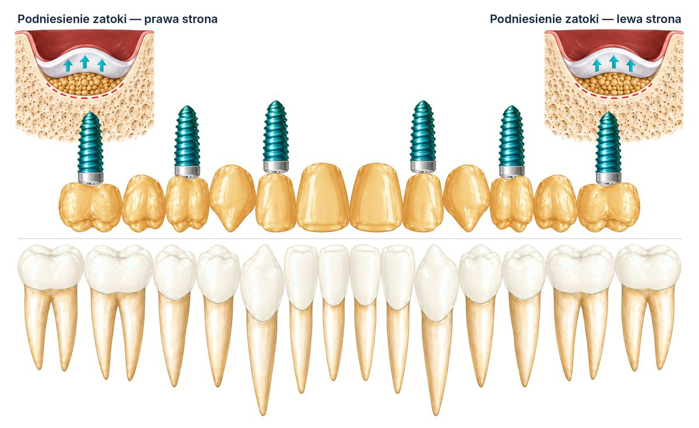

### 15 bez implantow proteza ruchoma i zatoki

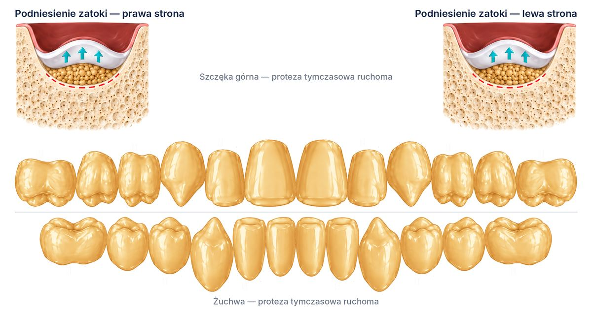

### 16 implanty z podniesieniem zatoki

Konfiguracja: [`catalog/16_implants_with_sinus_lift.json`](catalog/16_implants_with_sinus_lift.json)

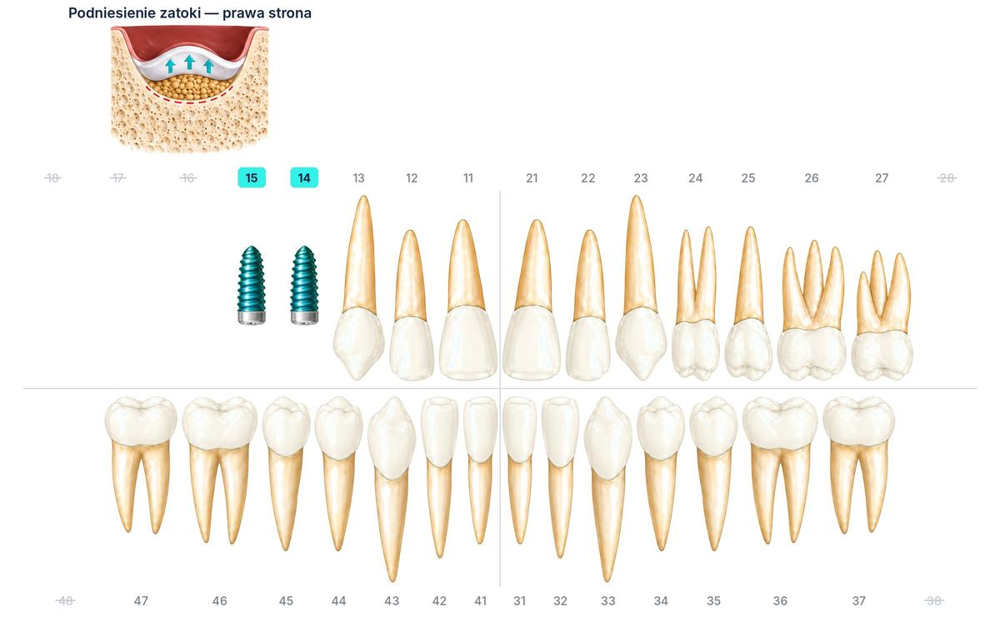

## 6. Wszystkie foldery biblioteki na Drive

| Folder | Liczba plików |
|---|---|
| [Bridge on Natural Teeth – Most na własnych zębach](https://drive.google.com/drive/folders/10o6vf0OHinLx4UfuLWBKAuKQXazpiPWC) | 64 |
| [Dental Implant – Implant](https://drive.google.com/drive/folders/1-Q8PUkKm-1exccWZSQpHOQFOKacp7TUA) | 32 |
| [Filling – Wypełnienie](https://drive.google.com/drive/folders/1XTny89gvVJZ-M0yJEfCDer9z3gtAThvC) | 32 |
| [Full Arch – Pełny łuk](https://drive.google.com/drive/folders/1Do85961dGxnqKyQ3veGQg50unc-9x4Yo) | 16 |
| [Implant Bridge – Most na implantach](https://drive.google.com/drive/folders/1Ftgqhobhviuh5hCObOM-SijT9vpnxAOH) | 64 |
| [Milk Tooth Extraction – Ekstrakcja zęba mlecznego](https://drive.google.com/drive/folders/1M6dgZ6DRcjMlrTkEGmJom8Jx0L-nFThK) | 20 |
| [PMMA Temporary Crown – Korona tymczasowa PMMA](https://drive.google.com/drive/folders/1fvyUnXIeNZ9awLWS3vImPzBz2Fmf-hdf) | 32 |
| [Root Canal Treatment – Leczenie kanałowe](https://drive.google.com/drive/folders/1JO24L8EuCqC9mMqOFDk9q9sTrNCIDFib) | 32 |
| [Sinus Lift – Podniesienie zatoki](https://drive.google.com/drive/folders/1rofLAvLWcZpVBpwTk0l1ZTBy2LV3lxcR) | 2 |
| [Temporary Crown on Implant – Korona tymczasowa na implancie](https://drive.google.com/drive/folders/17vvQUuHxupjLWVQ31C6LNCDU_POH_Rbe) | 32 |
| [Tooth Extraction – Ekstrakcja zęba](https://drive.google.com/drive/folders/1YLMCitgZqzHvG7HR3T1w6jZeNsFKsVjk) | 32 |
| [Veneer – Licówka](https://drive.google.com/drive/folders/1dqm1VJfF_k7eGoddJiX8aZczsnwfJFF0) | 20 |
| [Zirconia Crown on Implant – Korona cyrkonowa na implancie](https://drive.google.com/drive/folders/18B_6hV6D6C4hqSgArjVe80jtBzmLMOTI) | 32 |
| [Zirconia Crown – Korona cyrkonowa](https://drive.google.com/drive/folders/1yta_i1T1jaq5pJ4xGrwFIsYpV9cOoym8) | 32 |
| [Zirconia Implant – Implant cyrkonowy](https://drive.google.com/drive/folders/1NVC4CZ-SDpi_BYMeXLapuVmJLg2w85di) | 32 |
